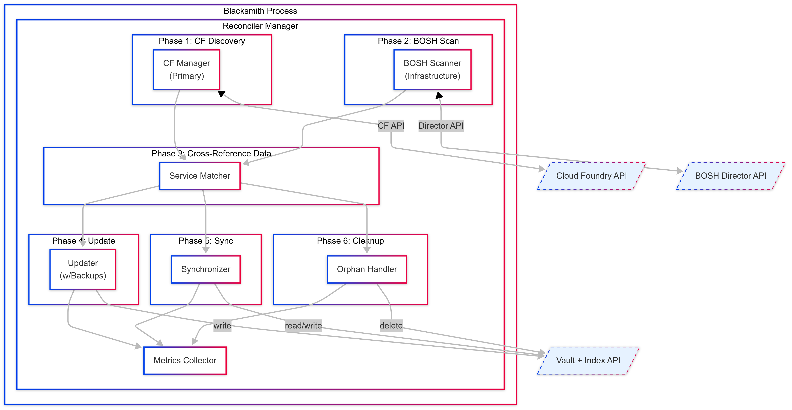

# Blacksmith Deployment Reconciler

## Overview

The Blacksmith Deployment Reconciler is a background service that automatically synchronizes service instance deployments information and state between Cloud Foundry (CF), BOSH Director, and Vault. It uses a CF-Query approach to ensure that
previously deployed active in CF services remain visible and manageable in Blacksmith even after restarts, failures, or data corruption.

## Purpose

The reconciler addresses the following operational challenges:

1. **Service Discovery** Finds all service instances deployed through Blacksmith by querying CF service broker endpoints
2. **Infrastructure Mapping** Correlates CF service instances with their corresponding BOSH deployments for infrastructure details
3. **Data Synchronization** Updates Vault with service instance metadata queried from both CF and BOSH
4. **Index Maintenance** Keeps the service instance index current and accurate
5. **Orphan Detection** Identifies orphaned instances (CF instances without BOSH deployments or vice versa)
6. **Credential Recovery** Reconstructs missing binding credentials from deployment manifests
7. **State Consistency** Ensures Blacksmith's internal state matches the actual deployed infrastructure and service names

## Architecture

The reconciler is implemented as a modular system with clean separation of concerns.



### Core Components

#### Manager (`reconcilerManager`)
- **Purpose**: Orchestrates the entire reconciliation workflow as a background goroutine
- **Responsibilities**:
  - Manages reconciliation lifecycle and scheduling
  - Coordinates all phases of the reconciliation process
  - Handles graceful shutdown and error recovery
  - Tracks reconciliation status and metrics

#### CF Manager
- **Purpose**: Primary source of service instance discovery
- **Responsibilities**:
  - Queries CF service broker endpoints for active service instances
  - Retrieves service instance metadata and binding information
  - Provides authoritative list of what should exist in Blacksmith

#### BOSH Scanner (`boshScanner`)
- **Purpose**: Scans BOSH Director for infrastructure details with intelligent caching
- **Responsibilities**:
  - Retrieves deployment information from BOSH Director
  - Caches deployment details to reduce API load
  - Extracts infrastructure metadata (VMs, releases, stemcells)
  - Parses manifest properties for service identification

#### Service Matcher (`serviceMatcher`)
- **Purpose**: Correlates CF service instances with BOSH deployments using multiple strategies
- **Responsibilities**:
  - Matches CF service instances to BOSH deployments by UUID
  - Uses manifest metadata for alternative matching
  - Validates deployment manifest structure
  - Handles edge cases and partial matches

#### Vault Updater (`vaultUpdater`)
- **Purpose**: Updates Vault storage with  instance data and manages backups
- **Responsibilities**:
  - Creates automatic backups before updates using SHA256-based deduplication
  - Updates instance metadata with reconciliation history
  - Manages backup retention and cleanup
  - Handles credential recovery and binding repair

#### Index Synchronizer (`indexSynchronizer`)
- **Purpose**: Maintains the service instance index for fast lookups
- **Responsibilities**:
  - Updates the central service instance index
  - Validates index consistency
  - Handles legacy deployment name formats
  - Ensures index accurately reflects current state

#### Metrics Collector (`metricsCollector`)
- **Purpose**: Tracks operational metrics for monitoring and observability
- **Responsibilities**:
  - Collects reconciliation performance metrics
  - Tracks error rates and recent failures
  - Renders its counters in the Prometheus text format, although no route serves them
  - Monitors system health indicators

## Configuration

The reconciler can be configured through both the `blacksmith.conf` file and environment variables, and environment variables take precedence over the file. The interval is the one exception, because an interval saved through the UI or the settings API outranks both. See [Interval Format and Precedence](#interval-format-and-precedence).

### Configuration Options

The settings below can come from the config file or from an environment variable, and the environment variable wins when both are set. A boolean environment variable is true when it holds `true`, `1`, or `yes`, and any other non-empty value makes it false.

| Environment Variable | Config File | Default | Description |
|---------------------|-------------|---------|-------------|
| `BLACKSMITH_RECONCILER_ENABLED` | `reconciler.enabled` | `true` | Enable/disable the reconciler |
| `BLACKSMITH_RECONCILER_INTERVAL` | `reconciler.interval` | `5m` | Time between reconciliation runs (Go duration or bare seconds) |
| `BLACKSMITH_RECONCILER_MAX_CONCURRENT` | `reconciler.max_concurrency` | `4` | Maximum deployments processed at the same time |
| `BLACKSMITH_RECONCILER_BATCH_SIZE` | `reconciler.batch_size` | `10` | Number of deployments to process per batch |
| `BLACKSMITH_RECONCILER_RETRY_ATTEMPTS` | `reconciler.retry_attempts` | `3` | Number of attempts for a failed operation |
| `BLACKSMITH_RECONCILER_DEBUG` | `reconciler.debug` | the top-level `debug` setting | Enable detailed debug logging |

The config file also accepts `reconciler.retry_delay` and `reconciler.cache_ttl`, and the broker reads both without error. Neither one has any effect, and neither has an environment variable. The delay between retries comes from `BLACKSMITH_RECONCILER_RETRY_INITIAL_DELAY`, and the deployment cache lives for a fixed five minutes.

The config loader can't tell a `false` in the file from a setting that was left out, so it treats both as unset and applies the default of `true`. That holds for `reconciler.enabled` and for every `reconciler.backup` switch. To turn one of them off, set its environment variable to `false`.

#### Interval Format and Precedence

The reconciler interval accepts a Go duration such as `"5m"`, `"30m"`, or `"1h30m"`, or a bare number of seconds such as `3600`. The default is five minutes, and the shortest interval the reconciler runs at is ten seconds. A value that can't be parsed doesn't stop Blacksmith from starting. Instead, Blacksmith logs a warning that names the setting, shows the bad value, and says which interval it uses in its place and where that interval came from.

A value under ten seconds from the environment variable, the config file, or Vault is raised to ten seconds, and Blacksmith logs a warning that names the setting, shows the value, and gives the minimum. The settings API rejects a value under ten seconds with a 400 response that names the minimum. Either way, Blacksmith and `GET /b/blacksmith/settings` report the interval the reconciler actually runs at.

Blacksmith takes the interval from the first of these sources that holds a valid value:

1. An interval saved through the UI or the settings API (`/b/blacksmith/settings`), which Blacksmith stores in Vault at `blacksmith/settings`

2. The `BLACKSMITH_RECONCILER_INTERVAL` environment variable

3. The `reconciler.interval` setting in the config file

4. The default of `5m`

A saved interval takes effect at once, and because it lives in Vault, it persists across restarts and redeploys. It overrides the environment variable and the config file, so operators can change the interval without a redeploy. Changing the environment variable or the config file has no effect on the interval while a saved value exists, so save a new interval through the UI or the settings API instead.

To change the interval at runtime, use the Broker settings page in the console or `POST /b/blacksmith/settings`, as [Changing the Interval at Runtime](#changing-the-interval-at-runtime) shows. The settings API takes the same forms as the config file. At startup, Blacksmith logs the interval it starts with and its source, and when it loads a saved interval from Vault, it logs which value the saved one replaces. If Blacksmith can't read the saved interval from Vault at startup, for example because Vault is still sealed, it logs a warning that says so and names the interval it runs with instead.

#### Backup Configuration

| Environment Variable | Config File | Default | Description |
|---------------------|-------------|---------|-------------|
| `BLACKSMITH_RECONCILER_BACKUP_ENABLED` | `reconciler.backup.enabled` | `true` | Enable/disable instance backups |
| `BLACKSMITH_RECONCILER_BACKUP_RETENTION` | `reconciler.backup.retention_count` | `5` | Number of backups to keep per instance |
| `BLACKSMITH_RECONCILER_BACKUP_RETENTION_DAYS` | `reconciler.backup.retention_days` | `0` | Days to retain backups (0 = disabled) |
| `BLACKSMITH_RECONCILER_BACKUP_COMPRESSION` | `reconciler.backup.compression_level` | `9` | Compression level (1-9, 9 = best) |
| `BLACKSMITH_RECONCILER_BACKUP_CLEANUP` | `reconciler.backup.cleanup_enabled` | `true` | Enable automatic cleanup of old backups |
| `BLACKSMITH_RECONCILER_BACKUP_ON_UPDATE` | `reconciler.backup.backup_on_update` | `true` | Create backup before instance updates |
| `BLACKSMITH_RECONCILER_BACKUP_ON_DELETE` | `reconciler.backup.backup_on_delete` | `true` | Create backup before instance deletion |

### Advanced Backup System

The reconciler implements a backup system with SHA256-based deduplication:

#### Backup Features
- **SHA256 Deduplication**: Prevents duplicate backups by content hashing
- **Automatic Backups**: Created before each reconciliation update
- **Configurable Retention**: Support for both count-based and time-based retention
- **Smart Cleanup**: Automatically removes old backups beyond retention limits
- **Compression**: Configurable compression levels (1-9) for space efficiency
- **Legacy Migration**: Automatically migrates old backup formats

#### What Gets Backed Up
- Complete instance Vault tree (all paths under the instance ID)
- Instance index data (service ID, plan ID, timestamps)
- Instance metadata (releases, stemcells, VMs, properties)
- Instance manifest (full BOSH deployment manifest)
- Binding credentials and metadata
- Reconciliation history and audit trail

#### Backup Storage Architecture
Backups use a SHA256-based storage system to prevent duplication:

```
backups/{instanceID}/{sha256hash}
├── timestamp: 1704397200
└── archive: <compressed_vault_export>
```

Example: `backups/abc-123-def-456/a1b2c3d4e5f6.../`

This approach ensures:
- **Space Efficiency**: Identical content is stored only once
- **Integrity Verification**: SHA256 hashes provide data integrity checks
- **Fast Deduplication**: Quick comparison without decompressing archives

### Configuration File Example

The config file holds only the settings in the two tables above. This is a complete `reconciler` section.

```yaml
# blacksmith.conf
reconciler:
  enabled: true
  interval: "30m"
  debug: false
  max_concurrency: 4
  batch_size: 10
  retry_attempts: 3
  backup:
    enabled: true
    retention_count: 10
    retention_days: 30
    compression_level: 9
    cleanup_enabled: true
    backup_on_update: true
    backup_on_delete: true
```

### Tuning With Environment Variables

The remaining knobs have no config file key, so an operator sets them as environment variables only.

| Environment Variable | Default | Description |
|---------------------|---------|-------------|
| `BLACKSMITH_RECONCILER_MAX_DEPLOYMENTS_PER_RUN` | `100` | Most deployments one run handles |
| `BLACKSMITH_RECONCILER_QUEUE_SIZE` | `1000` | Work queue size |
| `BLACKSMITH_RECONCILER_WORKER_POOL_SIZE` | `10` | Worker goroutines |
| `BLACKSMITH_RECONCILER_COOLDOWN_PERIOD` | `2s` | Pause between batches |
| `BLACKSMITH_RECONCILER_RETRY_INITIAL_DELAY` | `1s` | First retry delay, which doubles on each retry with 10 percent jitter |
| `BLACKSMITH_RECONCILER_RETRY_MAX_DELAY` | `30s` | Longest retry delay |
| `BLACKSMITH_RECONCILER_BATCH_DELAY` | `500ms` | Pause between batches |
| `BLACKSMITH_RECONCILER_MAX_PARALLEL_BATCH` | `2` | Batches processed in parallel |
| `BLACKSMITH_RECONCILER_ADAPTIVE_SCALING` | `true` | Adjust the batch size from observed performance |
| `BLACKSMITH_RECONCILER_MIN_BATCH_SIZE` | `5` | Smallest adaptive batch |
| `BLACKSMITH_RECONCILER_MAX_BATCH_SIZE` | `50` | Largest adaptive batch |
| `BLACKSMITH_RECONCILER_RUN_TIMEOUT` | `15m` | Deadline for one whole run |
| `BLACKSMITH_RECONCILER_SCAN_TIMEOUT` | `5m` | Deadline for the BOSH deployment scan |
| `BLACKSMITH_RECONCILER_DISCOVERY_TIMEOUT` | `3m` | Deadline for Cloud Foundry instance discovery |
| `BLACKSMITH_RECONCILER_VAULT_TIMEOUT` | `2m` | Deadline for Vault operations |
| `BLACKSMITH_RECONCILER_HEALTH_TIMEOUT` | `30s` | Deadline for health checks |
| `BLACKSMITH_RECONCILER_SHUTDOWN_TIMEOUT` | `30s` | Grace period at shutdown |
| `BLACKSMITH_RECONCILER_METRICS_ENABLED` | `true` | Collect metrics in memory |
| `BLACKSMITH_RECONCILER_METRICS_INTERVAL` | `30s` | How often metrics are collected |
| `BLACKSMITH_RECONCILER_METRICS_RETENTION` | `24h` | How long metrics are kept |
| `BLACKSMITH_RECONCILER_METRICS_PROMETHEUS` | `false` | Accepted, but nothing is exported yet (see [Metrics and Monitoring](#metrics-and-monitoring)) |
| `BLACKSMITH_RECONCILER_METRICS_PORT` | `9090` | Accepted, but nothing listens on it |

Durations take Go syntax such as `500ms` or `15m`, and a value that does not parse is ignored in favor of the default.

The rate limits, circuit breakers, and connection settings for the three systems the reconciler talks to use one naming pattern, `BLACKSMITH_<SYSTEM>_<SETTING>`, where the system is `BOSH`, `CF`, or `VAULT`.

| Setting | BOSH | CF | Vault |
|---------|------|----|-------|
| `REQUESTS_PER_SECOND` | `4` | `20` | `50` |
| `BURST` | `2` | `10` | `20` |
| `WAIT_TIMEOUT` | `5s` | `5s` | `3s` |
| `CIRCUIT_BREAKER` (on or off) | `true` | `true` | `true` |
| `FAILURE_THRESHOLD` | `5` | `3` | `5` |
| `SUCCESS_THRESHOLD` | `2` | `2` | `2` |
| `BREAKER_TIMEOUT` | `60s` | `30s` | `45s` |
| `BREAKER_MAX_CONCURRENT` | `1` | `2` | `3` |
| `TIMEOUT` | `30s` | `15s` | `10s` |
| `MAX_CONNECTIONS` | `bosh.max_connections`, which defaults to `4` | `20` | `30` |
| `KEEP_ALIVE` | `30s` | `30s` | `30s` |

For example, `BLACKSMITH_BOSH_REQUESTS_PER_SECOND=2` slows the reconciler's calls to the director.

### Environment Variable Example

```bash
# Basic reconciler configuration
export BLACKSMITH_RECONCILER_ENABLED=true
export BLACKSMITH_RECONCILER_INTERVAL=30m
export BLACKSMITH_RECONCILER_DEBUG=false

# Performance tuning
export BLACKSMITH_RECONCILER_MAX_CONCURRENT=6
export BLACKSMITH_RECONCILER_BATCH_SIZE=20
export BLACKSMITH_RECONCILER_RETRY_ATTEMPTS=5
export BLACKSMITH_RECONCILER_RETRY_INITIAL_DELAY=2s
export BLACKSMITH_BOSH_REQUESTS_PER_SECOND=8

# Backup configuration
export BLACKSMITH_RECONCILER_BACKUP_ENABLED=true
export BLACKSMITH_RECONCILER_BACKUP_RETENTION=10
export BLACKSMITH_RECONCILER_BACKUP_RETENTION_DAYS=30
export BLACKSMITH_RECONCILER_BACKUP_COMPRESSION=9
export BLACKSMITH_RECONCILER_BACKUP_CLEANUP=true
export BLACKSMITH_RECONCILER_BACKUP_ON_UPDATE=true
export BLACKSMITH_RECONCILER_BACKUP_ON_DELETE=true
```

As a rough guide to sizing, a director with 100 to 200 instances is comfortable at the defaults. Between 200 and 500 instances, raise `MAX_CONCURRENT` to 6, `BATCH_SIZE` to 20, and `BLACKSMITH_BOSH_REQUESTS_PER_SECOND` to 15. Past 500 instances, try 8, 30, and 20. Watch the director's response times, and lower the concurrency and the rate limits if calls start to time out.

### Configuration Precedence

Configuration values are applied in the following order, with the highest precedence first:

1. Environment variables

2. Configuration file (`blacksmith.conf`)

3. Default values

The reconciler interval is the exception. An interval saved through the UI or the settings API outranks the environment variable and the config file, and every source is held to a ten-second minimum. See [Interval Format and Precedence](#interval-format-and-precedence).

### Disabling Backups

To disable backup creation entirely:

```bash
export BLACKSMITH_RECONCILER_BACKUP_ENABLED=false
```

A `false` in `blacksmith.conf` does not disable backups, because the loader reads it as unset and applies the default of `true`. Use the environment variable.

### Unlimited Backup Retention

To keep all backups without automatic cleanup:

```bash
export BLACKSMITH_RECONCILER_BACKUP_CLEANUP=false
```

Or set retention to 0:
```bash
export BLACKSMITH_RECONCILER_BACKUP_RETENTION=0
```

## Matching Strategies

The reconciler uses multiple strategies to match BOSH deployments to service instances:

### 1. UUID Pattern Matching (Primary)

Deployments following the naming convention `{service-id}-{plan-id}-{instance-id}` are matched directly:

Example:
```
redis-cache-small-12345678-1234-1234-1234-123456789abc
```

In this example `service-id` is `redis`, `plan-id` is `cache-small` and `instance-id` is `12345678-1234-1234-1234-123456789abc`.

### 2. Manifest Metadata Matching

The reconciler checks deployment manifests for Blacksmith metadata:

```yaml
properties:
  blacksmith:
    service_id: redis-service
    plan_id: cache-small
    instance_id: 12345678-1234-1234-1234-123456789abc
```

### 3. Release-Based Matching

Deployments are matched based on their BOSH releases:

- Redis deployments: Contains `redis` release
- PostgreSQL deployments: Contains `postgres` release
- RabbitMQ deployments: Contains `rabbitmq` release

### 4. Pattern Recognition

The reconciler can identify services through deployment name patterns and manifest structure when other methods fail.

## Reconciliation Process

The reconciler uses six distinct phases for service discovery and synchronization:

### Phase 1: CF Service Discovery (Primary Source)
The reconciler starts by discovering service instances from Cloud Foundry, which serves as the authoritative source.

**Benefits of CF-query approach**:
- CF knows exactly which service instances should exist
- Provides service binding information
- Includes service parameters and user-provided metadata
- Handles multi-foundation deployments correctly

### Phase 2: BOSH Infrastructure Scanning
Scans BOSH Director for deployment infrastructure details.

**Infrastructure data collected**:
- Deployment manifests and properties
- VM information (IPs, instance groups, AZs)
- Release and stemcell versions
- Deployment timestamps and teams

### Phase 3: Cross-Reference and Data Building
Correlates CF service instances with BOSH deployments to build instance data.

**Matching strategies**:
1. **UUID Matching**: Direct correlation using service instance GUID
2. **Manifest Metadata**: Uses Blacksmith properties in deployment manifests
3. **Name Pattern Recognition**: Parses deployment names for service information
4. **Release-based Inference**: Identifies services by BOSH releases used

### Phase 4: Vault Update with Backup
Updates Vault with  data, creating backups for safety.

**Update process**:
- Creates SHA256-deduplicated backup before any changes
- Merges new data with existing instance metadata
- Adds reconciliation history and timestamps
- Preserves user-provided configuration and credentials

### Phase 5: Index Synchronization
Synchronizes the service instance index for fast lookups.

**Index operations**:
- Updates central service instance registry
- Validates index consistency
- Handles legacy deployment name formats
- Ensures fast service instance lookups

### Phase 6: Orphan Handling
Marks instances whose deployments have gone missing, and removes the marks that have gone unanswered. The next section describes the rules.

**Orphan types detected**:
- **Index orphans**: Vault index entries whose BOSH deployment no longer exists
- **Unclaimed deployments**: BOSH deployments that have neither a Vault index entry nor a Cloud Foundry service instance

## Orphan Detection

The reconciler handles an orphan in two steps, which are marking and sweeping. It never removes an entry the first time it finds the deployment missing.

### Marking

On each run, the reconciler compares the Vault index against the deployments the director reports. When an indexed service instance has no deployment and no Cloud Foundry match, the reconciler marks the entry as orphaned. The mark records `orphaned`, `orphaned_at`, and an `orphaned_reason` of `no_bosh_deployment`. On every later run that still finds the deployment missing, the reconciler adds one to the entry's `orphan_check_count`.

The reconciler marks nothing when the deployment scan comes back empty, because an empty scan is more likely a failed scan than an empty director. When a deployment shows up again, the reconciler clears the mark and counts.

### Removing marked entries

A marked entry stays in the index until one of two limits is reached, and whichever comes first wins.

- The entry was marked more than 24 hours ago.

- The reconciler has found the deployment missing on 24 runs.

Every start of the broker resets the clock on all marked entries, so operators get a fresh 24 hours after a redeploy to investigate before anything is removed. Removing an entry deletes the index record only. The instance's secrets stay in Vault, as they do after a normal deprovision, so they remain available for audits.

### The faster sweep

A separate sweep removes an entry without waiting for those limits, but only when the evidence is strong. It removes an index entry when all of these hold.

- The entry is at least two hours old, so a provision that has not reached BOSH yet is not mistaken for an orphan.

- The director answers a direct request for the deployment with a 404. A deployment that is missing from the list, or one with an empty manifest, does not count.

- The director has no running task on that deployment.

- The instance's task record in Vault shows no provision in flight and no action whose outcome is unknown.

A tombstone, which is an entry the VM monitor marked `deleted` after the director answered 404, goes through the same checks. A tombstone that names no deployment has nothing left to confirm, so its age alone decides.

Once the sweep removes an entry, it hands the entry's deployment to the CredHub cleanup, which is described under `credhub.cleanup` in [config.md](config.md).

### Unclaimed deployments

When Cloud Foundry discovery completes, the reconciler reports any BOSH deployment that has no index entry and no Cloud Foundry service instance, and it leaves that deployment alone. Adopting it would give the broker a live-looking instance for a service that no longer exists. Until a run with complete discovery has happened, the broker has no answer to give, and the console shows the list as unchecked.

### Seeing what is marked

`GET /b/orphans` lists every marked entry with the time left before removal, and it lists the unclaimed deployments. See [API Endpoints](#api-endpoints).

## Metrics and Monitoring

The reconciler keeps operational metrics in memory while it runs.

### What the Collector Tracks

- Total, successful, and failed reconciliation runs

- The total, average, and last run duration

- Deployments scanned, instances found, instances synchronized, and errors encountered

### Prometheus Text Format

The collector can render its counters in the Prometheus text format, with these names.

```
blacksmith_reconciler_runs_total
blacksmith_reconciler_runs_successful
blacksmith_reconciler_runs_failed
blacksmith_reconciler_last_run_duration_seconds
blacksmith_reconciler_deployments_total
blacksmith_reconciler_instances_found_total
blacksmith_reconciler_instances_synced_total
blacksmith_reconciler_errors_total
```

### Reaching the Metrics

The broker does not expose reconciler metrics or status over HTTP. No route serves them, and `BLACKSMITH_RECONCILER_METRICS_PROMETHEUS` and `BLACKSMITH_RECONCILER_METRICS_PORT` are accepted but start no listener, so there is nothing for a Prometheus server to scrape. The collector keeps its numbers in memory for the running process.

To see what the reconciler is doing, read its log lines. Each run logs an `Index synchronized` line that counts the entries it updated, added, marked orphaned, un-orphaned, and removed. For the orphan state, call `GET /b/orphans`.

## Logging

The reconciler provides  logging at different levels:

### Debug Logging
Enable debug logging for detailed reconciliation information:

```bash
export BLACKSMITH_RECONCILER_DEBUG=true
# or use global debug
export BLACKSMITH_DEBUG=true
```

Debug logs include:
- CF service instance discovery details
- BOSH deployment scanning with cache hits/misses
- Cross-referencing decisions and matching logic
- Individual update operations and backup creation
- Index synchronization operations
- Orphan detection and handling

### Info Logging
Standard operational logs:
- Reconciliation start/completion with timing
- CF service instance discovery results
- BOSH deployment scanning results
- Cross-referencing and matching outcomes
- Vault update and synchronization results
- Orphan detection findings

### Error Logging
Critical issues that require attention:
- CF service broker connection failures
- BOSH Director connection failures
- Vault access errors
- Backup creation failures
- Index synchronization errors
- Credential recovery failures

## Error Handling

The reconciler implements robust error handling:

### Retry Logic
Failed operations are retried with exponential backoff. The first delay is one second and it doubles on each retry up to a limit of 30 seconds, with 10 percent jitter added. The number of attempts defaults to three. See [Tuning With Environment Variables](#tuning-with-environment-variables) for the settings.

### Partial Failure Handling
The reconciler continues processing even when individual deployments fail:
- Failed deployments are logged but don't stop the reconciliation
- Metrics track failed operations for monitoring
- Next reconciliation attempt will retry failed deployments

### Graceful Shutdown
When the broker stops, the reconciler stops its background workers and gives a running reconciliation up to 30 seconds to finish. `BLACKSMITH_RECONCILER_SHUTDOWN_TIMEOUT` changes that grace period.

## Performance Considerations

### Caching
Deployment details are cached to reduce BOSH API calls:
- The cache lives for a fixed five minutes, and no setting changes that
- Expired entries are dropped when they are next read

### Concurrency Control
The reconciler processes deployments concurrently with limits:
- Default: 4 concurrent operations
- Prevents overwhelming BOSH Director
- Configurable based on deployment size

### Batch Processing
Large deployment lists are processed in batches:
- Default batch size: 10 deployments
- Reduces memory usage
- Enables progress tracking

## Troubleshooting

In the examples below, `BROKER_USER` and `BROKER_PASS` hold the broker's basic-auth credentials, and `blacksmith.example.com` stands for the broker's address.

### Reconciler Not Starting

Check whether the reconciler is enabled. The environment variable decides first, so a value of `false` there turns it off whatever the config file says.
```bash
echo $BLACKSMITH_RECONCILER_ENABLED
```

Check the logs for initialization messages. A healthy start logs `Initializing deployment reconciler`, then the line `Reconciler interval:` with the interval and where it came from, and finally `Deployment reconciler started successfully`. A disabled reconciler logs `Deployment reconciler is disabled`.
```bash
grep "reconciler" blacksmith.log
```

The reconciler waits up to 30 seconds for Vault to be ready. If Vault never answers, the log says the reconciler runs with degraded functionality.

Confirm the interval the running reconciler uses. The answer holds `reconciler_interval`, and it carries a Vault-saved value when one exists.
```bash
curl -s -u "$BROKER_USER:$BROKER_PASS" https://blacksmith.example.com/b/blacksmith/settings | jq .reconciler_interval
```

### CF Service Discovery Issues

Enable debug logging to see CF discovery details:
```bash
export BLACKSMITH_RECONCILER_DEBUG=true
```

Verify CF connectivity and service broker registration:
```bash
# Check CF connection
cf api
cf auth

# Verify service broker registration
cf service-brokers | grep blacksmith

# Check service instances
cf service-instances
```

### BOSH Deployment Scanning Issues

Verify BOSH Director connectivity and authentication. In the examples below, `BROKER_USER` and `BROKER_PASS` hold the broker's basic-auth credentials. A list of tasks means the director answered and accepted Blacksmith's credentials, and an error names the director URL and the HTTP status:
```bash
curl -s -u "$BROKER_USER:$BROKER_PASS" https://blacksmith.example.com/b/tasks | jq .
```

For the Genesis kit, run the same request through Genesis:
```bash
genesis do <env> -- curl /b/tasks
```

Read the event output of a task from the `/b/tasks` list, using its task ID:
```bash
curl -s -u "$BROKER_USER:$BROKER_PASS" "https://blacksmith.example.com/b/tasks/<task-id>/output?type=event"
```

### Matching and Cross-Reference Failures

Check deployment naming conventions:
- Should follow `{serviceID}-{planID}-{instanceID}` pattern
- Instance ID should be a valid UUID matching CF service instance GUID

Verify manifest metadata in BOSH deployments by reading the manifest text from the manifest route. The route answers HTTP 404 for a deployment the director does not know and HTTP 500 when the director call fails, and both answers carry the reason in their `error` field. With `-f`, curl prints nothing and exits non-zero on either answer, so a manifest in the output proves the deployment exists:
```bash
curl -sf -u "$BROKER_USER:$BROKER_PASS" https://blacksmith.example.com/b/deployments/<deployment-name>/manifest | jq -r .text | grep -A5 -B5 blacksmith
```

An empty `text` means the deployment exists but its first deploy has not finished, so the director has no manifest for it yet.

Enable verbose logging to see matching decisions:
```bash
export BLACKSMITH_RECONCILER_DEBUG=true
grep "matching\|cross-reference" blacksmith.log
```

### Performance Issues

Adjust concurrency settings:
```bash
# Reduce concurrency for slower systems
export BLACKSMITH_RECONCILER_MAX_CONCURRENT=2
export BLACKSMITH_RECONCILER_BATCH_SIZE=5

# Slow the reconciler's calls to the director
export BLACKSMITH_BOSH_REQUESTS_PER_SECOND=2
```

### Orphans That Never Clear

List the marked entries and the unclaimed deployments, with the time left before each removal:
```bash
curl -s -u "$BROKER_USER:$BROKER_PASS" https://blacksmith.example.com/b/orphans | jq .
```

An entry with a `seconds_left` of null has no limit the broker can time, and an entry with `due` set to true goes on the next run. An empty `unclaimed` list means something only when `unclaimed_known` is true, because the broker cannot say until a run has finished Cloud Foundry discovery. See [Orphan Detection](#orphan-detection) for the rules.

### Changing the Interval or Forcing a Run

Change the interval through the settings API or the Broker settings page in the console. The change takes effect at once. See [Changing the Interval at Runtime](#changing-the-interval-at-runtime).

The broker has no route that starts a run on demand. The reconciler runs once when the broker starts and then on every interval, so lowering the interval or restarting the broker is how an operator gets a run sooner.

## Integration with Blacksmith

The reconciler integrates seamlessly with existing Blacksmith components using a layered approach:

### Cloud Foundry Integration
- **Service Broker Discovery**: Automatically discovers service instances from CF service broker endpoints
- **Multi-Foundation Support**: Works across multiple CF foundations
- **Binding Metadata**: Retrieves service binding information for credential recovery
- **OSB Compatibility**: Maintains full Open Service Broker API compatibility
- **CF API Integration**: Uses Blacksmith's existing CF connection management

### Broker Integration
- **Service Catalog Access**: Reads service definitions for intelligent matching
- **Plan Metadata**: Uses service plan information for deployment correlation
- **Credential Recovery**: Leverages broker interfaces for binding reconstruction
- **Registry Updates**: Maintains service instance registry consistency

### Vault Integration
- **Secure Storage**: Stores all deployment metadata and credentials in Vault
- **Backup Management**: Creates compressed, deduplicated backups with SHA256 hashing
- **History Tracking**: Maintains complete reconciliation history and audit trails
- **Index Maintenance**: Updates central service instance index for fast lookups
- **Credential Preservation**: Protects existing credentials and user-provided parameters

### BOSH Integration
- **Director Connection**: Uses existing BOSH Director connection and authentication
- **Deployment Scanning**: Retrieves infrastructure details from all deployments
- **Manifest Parsing**: Extracts service metadata from deployment manifests
- **Infrastructure Mapping**: Correlates VMs, releases, and stemcells with service instances
- **Caching Layer**: Implements intelligent caching to reduce BOSH API load

## Best Practices

### Operational Guidelines

1. **Regular Monitoring**: Check reconciler metrics and status regularly
   - Read the `Index synchronized` log line after each run
   - Check `GET /b/orphans` for entries waiting for removal
   - Review error logs for failed reconciliation attempts

2. **Appropriate Intervals**: Set reconciliation frequency based on environment:
   - **Default**: 5 minutes
   - **Stable environments**: 30 minutes to 2 hours when instances rarely change
   - **Development**: 10 seconds is the shortest interval the reconciler accepts
   - **Large Environments**: Consider longer intervals to reduce system load

3. **Resource Allocation**: Size resources appropriately:
   - **CPU**: Minimal impact during normal operation
   - **Memory**: Scales with CF service instances × BOSH deployments
   - **Network**: Depends on CF API and BOSH API response sizes
   - **Vault Storage**: Account for backup storage requirements

### Performance Optimization

4. **Concurrency Tuning**: Adjust based on your infrastructure capacity:
   ```bash
   # For smaller environments
   export BLACKSMITH_RECONCILER_MAX_CONCURRENT=3
   export BLACKSMITH_RECONCILER_BATCH_SIZE=5

   # For larger, robust environments
   export BLACKSMITH_RECONCILER_MAX_CONCURRENT=15
   export BLACKSMITH_RECONCILER_BATCH_SIZE=25
   ```

5. **Backup Optimization**: Configure backup settings for storage efficiency:
   ```bash
   # Space-conscious environments
   export BLACKSMITH_RECONCILER_BACKUP_COMPRESSION=9
   export BLACKSMITH_RECONCILER_BACKUP_RETENTION=3

   # Compliance-focused environments
   export BLACKSMITH_RECONCILER_BACKUP_RETENTION_DAYS=90
   export BLACKSMITH_RECONCILER_BACKUP_CLEANUP=false
   ```

### Operational Procedures

6. **Error Investigation**: Investigate issues systematically:
   - **Index orphans**: Usually mean someone deleted a deployment by hand, or a deprovision did not finish
   - **Unclaimed deployments**: Often follow a deprovision that raced a provision

7. **Maintenance Windows**: Plan reconciler operations around maintenance:
   - Disable reconciler during major CF/BOSH maintenance
   - Lower the interval for a while after significant infrastructure changes
   - Monitor increased activity after system restarts

## CF-Query Workflow Deep Dive

The reconciler's CF-Query approach represents a significant architectural improvement over traditional BOSH-centric reconciliation:

### Why CF-Query?

**Traditional Problems with BOSH-Only Reconciliation**:
- BOSH deployments may exist without corresponding CF service instances
- Deployment names don't always follow consistent patterns
- Missing service binding information
- Difficulty handling multi-foundation environments
- No authoritative source of "what should exist"

**CF-Query Advantages**:
- CF service broker provides authoritative list of active service instances
- Includes complete service binding metadata
- Handles complex deployment scenarios (updates, migrations)
- Provides user context and service parameters
- Works seamlessly across multiple foundations

### Fallback Mechanisms

The reconciler gracefully handles partial failures:
- **CF Unavailable**: Falls back to BOSH-only reconciliation
- **BOSH Unavailable**: Processes CF instances without infrastructure details
- **Partial Data**: Records what's available and attempts recovery on next run

## Security Considerations

The reconciler operates with  security measures:

### Access Control
- **CF Access**: Uses Blacksmith's CF client credentials and authentication
- **BOSH Access**: Uses configured BOSH Director credentials and certificates
- **Vault Access**: Uses Blacksmith's Vault token with appropriate policies
- **No Additional Permissions**: Doesn't require extra privileges beyond Blacksmith's existing access

### Data Protection
- **Secure Metadata**: All sensitive information stored in Vault with encryption
- **Backup Encryption**: Backup archives use Vault's native encryption
- **Credential Isolation**: Service instance credentials remain isolated and secure
- **Audit Trail**: Complete reconciliation history logged for compliance

### Network Security
- **TLS Communication**: All external API calls use TLS encryption
- **Certificate Validation**: Validates certificates for CF and BOSH connections
- **Network Isolation**: Respects existing network policies and firewalls

## API Endpoints

Every route here sits behind the broker's basic authentication. The reconciler has no routes of its own for status, metrics, or starting a run.

### Orphans

`GET /b/orphans` lists the index entries the reconciler marked orphaned and the unclaimed BOSH deployments.

```bash
curl -s -u "$BROKER_USER:$BROKER_PASS" https://blacksmith.example.com/b/orphans | jq .
```

The answer has these fields.

- `orphans` holds the marked entries, soonest removal first. Each one has `instance_id`, `instance_name`, `deployment_name`, `service_id`, `plan_id`, `orphaned_at`, `reason`, and `check_count`. It also carries `seconds_left`, which is null when no limit can be timed, `due`, which is true when the next run removes the entry, and `basis`, which says whether the 24-hour limit (`age`) or the 24-run limit (`checks`) comes first.

- `unclaimed` holds the deployments with no index entry and no Cloud Foundry instance, each with `deployment_name`, `instance_id`, and `first_seen`.

- `unclaimed_known` is false until a run with complete Cloud Foundry discovery has happened, and `unclaimed_as_of` gives the time of that run.

- `removal_after_seconds` is the 24-hour limit in seconds, and `timestamp` is the time of the answer.

### Changing the Interval at Runtime

`GET /b/blacksmith/settings` returns the settings the console shows, which include `reconciler_interval` as a Go duration string such as `5m0s`.

`POST /b/blacksmith/settings` changes them. The body is JSON, and a field that is left out stays as it is.

```bash
curl -s -u "$BROKER_USER:$BROKER_PASS" -X POST \
  -H 'Content-Type: application/json' \
  -d '{"reconciler_interval": "10m"}' \
  https://blacksmith.example.com/b/blacksmith/settings
```

The value takes the same forms as the config file, a Go duration or bare seconds, and the shortest value it accepts is ten seconds. A shorter or unparseable value gets a 400 response that names the minimum. The broker saves the value to Vault first and applies it only after the save lands, so a failed save changes nothing and answers 500. The new interval takes effect at once, and it survives restarts because it is stored in Vault. It also outranks the environment variable and the config file, as [Interval Format and Precedence](#interval-format-and-precedence) explains.

The Broker settings page in the console makes the same call.

### Recent Changes

The broker audits changes to its settings, including the reconciler interval, and it also audits Cloud Foundry endpoint registrations and instance restart and recreate attempts. `GET /b/blacksmith/changes` returns the newest records, and it takes `scope` (`settings`, `endpoints`, or `instances`, with `settings` the default) and `limit` (1 to 100, with 10 the default). A record shows the old and new values of a setting, and secret values never appear. The console shows the same records on its Settings and Endpoints pages.

### Cleanup

`POST /b/cleanup` answers 501 with a message that says manual cleanup is not implemented. The reconciler removes orphaned entries on its own, as [Orphan Detection](#orphan-detection) describes, and `GET /b/orphans` shows what is waiting.

## Future Enhancements

Planned improvements for the reconciler:

1. **Enhanced Web UI** Real-time reconciliation dashboard with detailed status
2. **Webhook Notifications** Configurable alerts for orphaned instances and failures
3. **Selective Reconciliation** API endpoints to reconcile specific services or instances
4. **Custom Matching Rules** User-defined deployment matching strategies
5. **Multi-Foundation Support** Enhanced CF integration across multiple foundations
6. **Historical Analytics** Long-term trends and reconciliation performance analysis
7. **Operator-triggered cleanup** An on-demand job behind `POST /b/cleanup`, which answers 501 until it exists
8. **Multi-BOSH Support** Reconcile across multiple BOSH Directors simultaneously
9. **Advanced Backup Features** Incremental backups and cross-instance deduplication
10. **Integration Testing** Built-in health checks and dependency validation
