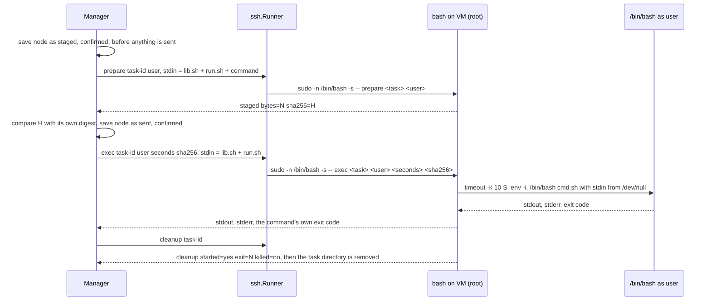
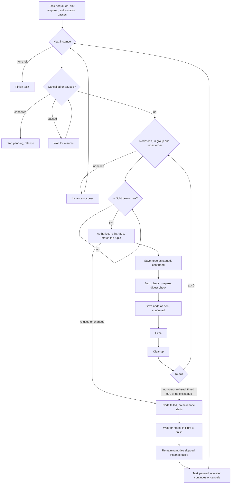

# Run Command Batch Operation

The Run command operation lets an operator run one maintenance command on every VM of every deployment behind a chosen set of service instances. A typical use is enabling a RabbitMQ feature flag with `/var/vcap/packages/rabbitmq/sbin/rabbitmqctl` on each RabbitMQ VM. It is a batch operation that sits beside Upgrade and Rotate certificates in the broker UI.

This feature runs arbitrary operator text on customer VMs, and sometimes as root, so we treat it as security-sensitive. This document explains what the operation does, how we configure and authorize it, and what we can and cannot promise about it.

## Table of Contents

- [Overview](#overview)

- [Configuration](#configuration)

- [Who May Run Commands](#who-may-run-commands)

- [Running a Command in the UI](#running-a-command-in-the-ui)

- [How the Command Reaches the VM](#how-the-command-reaches-the-vm)

- [Targets](#targets)

- [Execution](#execution)

- [Output](#output)

- [Audit](#audit)

- [HTTP API](#http-api)

- [Node Scripts](#node-scripts)

- [What It Will Not Do](#what-it-will-not-do)

## Overview

An operator selects service instances, types a command, and picks the user the command runs as, which is either `root` or `vcap`. The shell is always `/bin/bash`, and nobody can change it in this version. The broker then runs the command on every VM of every deployment in the selection.

The operation reuses the path the certificate patch already uses to run root scripts on service VMs over BOSH SSH. It does not use the older SSH executor, which builds one shell string around the command and retries connection failures. Neither of those behaviors is acceptable for an arbitrary command.

Every run follows the same shape.

1. The operator previews the run, and the broker lists every VM it would touch.

2. The operator reviews the list and types a confirmation word.

3. The broker runs the command on one node at a time, unless the operator turned on the parallel option.

4. The broker keeps each node's output and writes an audit record.

## Configuration

The operation is controlled by the `commands` block, and the parallel option is bounded by `bosh.director_workers`. The full reference for both lives in [config.md](config.md#commands-configuration-commands), and this is the short form.

```yaml
commands:
  enabled: true          # the whole operation; unset means on
  allow_root: false      # runs as root; unset means off
  credential:            # optional second credential; unset means none
    key: ""              # when set, every preview, create, and output read must send it
bosh:
  director_workers: 0    # the director's worker count; unset means 4, so max in flight tops out at 3
```

With no configuration at all, the operation is on, operators can run as `vcap` only, and no second credential is required. A deployment turns on root deliberately by setting `allow_root` to true.

## Who May Run Commands

The operation uses the existing broker credential, which is the HTTP basic auth the broker already requires. The broker has no roles today, so we add some checks on top of that credential.

The first is the `commands.enabled` switch, which turns the whole operation on or off. The second is the `commands.allow_root` switch, which applies only to a run as root. We also support an optional second credential, `commands.credential.key`. When a key is configured, it becomes required for this operation. The client sends it in the `X-Blacksmith-Command-Key` header and never in the JSON body. The broker compares it in constant time, and the request-header debug log redacts it.

The checks live behind one interface, `CommandAuthorizer`, in the upgrade package, so that a later RBAC or OAuth integration can replace the implementation without reworking the operation. The first implementation, `ConfigAuthorizer`, reads the `commands` block on every call, so a change in the configuration takes effect at the next check a stored task reaches. It answers three kinds of question.

- A preview or a create is refused with 403 `commands_disabled` when the feature is off, with 403 `root_disabled` when the run is as root and root runs are off, and with 401 `command_credential_required` when a key is configured and the request does not carry the right one. A user other than `root` or `vcap` is refused with 400 `invalid_run_user`.

- An output read, and the detail view of a command task, are refused with 403 `commands_disabled` when the feature is off and with 401 `command_credential_required` under the same key rule. They never look at `allow_root`, because reading what a past run printed is an audit read. An operator investigating a root run must not be locked out by the switch that stops the next one.

- The broker checks a stored task before it queues the task and before it resumes the task. It checks the task again at each node, once before it stages the command and once more just before it sends the command. A stored task has no request to read, so these checks apply only the two switches to the user the task was created with. Turning `allow_root` off therefore stops every stored root task at the next check it reaches.

A resume that sends a command takes the second credential as well, because it can send a stored command to VMs. A resume that only cleans up a cancelled task never asks for the key.

The UI enforces nothing on its own. Every one of these checks happens on the server.

## Running a Command in the UI

Choose Run command in the operation selector of the Batch Operations tab. The page probes the preview endpoint when it loads. The radio is disabled, with the reason shown, when the broker answers 403 `commands_disabled`. When the broker answers 403 `root_disabled`, only the root choice is disabled. The flow has the same three steps as the other operations.

### Options

The Options step holds the command, the user, and the limits.

- The command box accepts text of any shape. The help line reminds the operator that the command runs under `/bin/bash` on every node with stdin closed and a fixed `PATH`.

- A radio pair picks the user, with `vcap` as the default. Root is marked as needing care, and it is disabled with a note when the preview reports that root is off.

- A read-only line shows the shell, which is `/bin/bash` and fixed in this version.

- The timeout input takes seconds, with a default of 600 and a range of 10 through 3600.

- The parallel checkbox is off by default. Turning it on reveals a max-in-flight input that is bounded by the limit the preview reports. See [Parallel runs](#parallel-runs).

- The optional job name and reason inputs work as they do for the other operations.

Next stays disabled while the command is empty or only whitespace, while the timeout is not a whole number in range, and while parallel is on and the max in flight is empty, below 1, or above the limit the preview reports. It also stays disabled after the broker refuses a set of options, until the operator changes them.

### Instances

The Instances step reuses the instance list that Upgrade uses, with its filters, bulk selection, pager, and checkboxes. It works with the certificate inventory off, loading, or failed. A selection may span more than one service. The options summary then says so, for example "across 2 services".

### Review and confirm

The Review step calls the preview endpoint and freezes the values it sent. It shows the command in a preformatted block, the user, the shell, the timeout, and the parallel settings, followed by one table per deployment with the columns Node, AZ, State, Job state, and Targeted. A node that is not targeted shows its reason. Any edit to the command, the user, the timeout, the parallel settings, or the selection drops the review and requires a fresh one.

Hidden characters in the command text and in the reason are made visible. Control characters, the bidirectional formatting characters, the zero-width characters, and the soft hyphen, all of which could disguise what a command does, are shown as `\u` escapes such as `\u202E`, and a note tells the operator the command contains them. The text that runs is never changed, so the escapes are only a way to see what is there.

When the selection spans more than one service, the preview carries a `mixed_services` warning, and the review shows a prominent warning block that names the services. The backend allows the run. A command is usually specific to one service, so the warning is there to make a mistaken selection obvious and not to stop a deliberate one.

When the broker has a second credential configured and the request carries none or the wrong one, it answers 401, and the review step asks for the key in a password input. After a wrong key, the prompt says the broker did not accept it. The key goes in the `X-Blacksmith-Command-Key` header on the preview, the create, and the output reads. The UI holds it in memory only, for those requests, and never keeps it in a draft or in browser storage.

The operator must always type a confirmation word. There is no instance-count threshold for this operation, because the action is arbitrary code on customer VMs and the cost of a mistaken click is unbounded. The word names the privilege, so it is `run as root` or `run as vcap`. Case and spacing are forgiven, and the confirm button stays disabled until the word matches. The button reads "Run on N nodes". The server also binds the preview to the command, the user, the timeout, the parallel settings, and the targets, which is what makes the typed word mean something.

An expired preview refreshes with a fresh confirmation before it submits.

### When a create does not answer

If a create request gets no answer, the review keeps it pending and offers Retry and Discard.

Retry resends the identical request. Discard asks the broker to give the request up, sending only the `client_request_id` and the preview ID, and no command key is needed because a discard can only stop a run and never start one. The broker revokes the preview, so a create with that request ID that is still on its way, or still being processed, is refused and no task is made. If a create with that ID is already under way, the broker lets it finish first. When the broker confirms the discard, the pending create is cleared, its ID is never sent again, and a note says Blacksmith will refuse the request if it arrives late. If a task already exists for the request, the run started, and Activity opens on that task. If the broker cannot be reached or does not give a clear answer, the review offers a danger-styled Discard anyway, with a warning that the operator should check Activity before running the command again. Discard anyway clears the create only in the browser, so a run that appears later in Activity would have come from the discarded request.

### Activity and the task view

Activity shows a Command badge beside the Certificates one, with the first twelve characters of the command's digest and never the text. The task detail shows the command, the user, the shell, the timeout, the parallel settings, and the reason, and it lists each node with its status, exit code, and duration.

When the broker has a second credential configured, the task detail asks for the command key before it shows the task. The pane shows a password input and a Show task button. An output read asks for the key the same way, with a Show output button, and a resume that sends a command asks with a Use key button. When the broker does not accept a key, the operator is taken to the task detail pane, which says so and asks for the key again. The held key is dropped when the operator clears it, and doing so also drops the command text and the output from the page.

Each node has a collapsed Output element that fetches that node's output the first time the operator opens it and shows stdout and stderr in separate blocks. The text is rendered as plain text, with control characters other than newline and tab removed. The summary line reads like "Output (stdout 1.2 KiB, stderr 0 B)", and a stream that was cut reads like "stdout 64.0 KiB of 130.0 KiB (truncated)". A node that settled without running anything has no stored output, so its summary reads "Output (none kept)", it sends no request, and it says the node produced no output along with the reason when there is one.

A paused command task offers the "Continue remaining instances" control that the certificate tasks already have. When the broker can't confirm that the command has ended on every node, for example because a node's processes outlived KILL or a lost answer left a node stranded, the control reads Resume cleanup instead. Resume cleanup runs `cleanup` again on those nodes and sends no command, so the operator uses it to release a held instance once its processes have ended, and the task then pauses before the nodes that haven't run the command.

## How the Command Reaches the VM

The command is operator-typed text of any shape, so it travels only on stdin and is never part of any command line. A script named `run.sh` does the work on the VM. It has three operations, and the command line on the VM is always the following, where only fixed words and strictly validated tokens ever appear in it.

```
sudo -n /bin/bash -s -- <op> <task-id> [<user> <seconds> <sha256>]
```



Before any of the three operations, the broker runs `sudo -n true` once on each VM, so a VM without passwordless sudo fails with that reason before any script is sent.

### Prepare

The stdin of `prepare` is the library, then `run.sh`, then the command bytes, with nothing added between them. `run.sh` ends with a line that exits unconditionally, so when `prepare` refuses before it reads, the unread command bytes are discarded with the session and are never read as shell.

The `prepare` operation creates `/var/vcap/data/runcmd`, which root owns and which has mode 0711. Inside it, `prepare` creates a directory for the task. Root owns that directory too, it carries vcap's group, and its mode is 0710. The operation then writes the command to `cmd.sh` in that directory as root, with mode 0640 and vcap's group. The user `vcap` can open `cmd.sh` by name and cannot list, replace, write, or remove anything on the way to it. When the user is root, the layout is the same. The operation prints the byte count and the SHA-256 of what it stored, and the broker compares that digest with its own. A mismatch means stdin was cut short or altered, and the node fails before anything runs.

### Exec

The `exec` operation checks the directories and the file again and re-hashes `cmd.sh`. It refuses with exit code 13 when the hash is not the one the broker sent. It then launches the command in a new session, records the process group in a file, and gives the command stdin from `/dev/null`, so a command that reads stdin sees end of file and neither hangs nor eats the script. The launch runs under `timeout -k 10 <seconds>`, which sends TERM at the deadline and KILL ten seconds later. The wrapper records the command's exit code and exits with that same code, so the SSH exit status is the command's own.

### The environment the command sees

The command starts with an empty environment and receives exactly the following values.

| Variable | root | vcap |
|----------|------|------|
| `HOME` | `/root` | `/home/vcap` |
| Working directory | `/root` | `/home/vcap` |
| `USER`, `LOGNAME` | `root` | `vcap` |
| `SHELL` | `/bin/bash` | `/bin/bash` |
| `PATH` | `/var/vcap/bosh/bin:/usr/local/sbin:/usr/local/bin:/usr/sbin:/usr/bin:/sbin:/bin` | `/var/vcap/bosh/bin:/usr/local/bin:/usr/bin:/bin` |
| `LANG`, `LC_ALL` | `C.UTF-8` | `C.UTF-8` |
| `TMPDIR` | `/var/vcap/data/tmp` | `/var/vcap/data/tmp` |
| `BLACKSMITH_RUN_TASK` | the task ID | the task ID |
| umask | `022` | `022` |

Service packages are not on `PATH` on purpose. A command should spell the full path, as in the RabbitMQ example above, and a fixed `PATH` means a command does the same thing on every node of every service. The `/var/vcap/bosh/bin` entry is there so `monit` resolves for root.

For `vcap`, the wrapper looks up the account with `getent passwd vcap` and refuses a uid or gid of 0. It also checks that the home directory is a real directory, not a symlink, and is owned by exactly that uid and gid. It then drops privileges with `setpriv` before the command starts.

### Cleanup

The `cleanup` operation prints whether the command started, how it exited, and whether the wrapper had to kill anything. Whenever the command has started, `cleanup` checks the command's session whatever the exit status was, because a command that exits 0 can still leave processes behind. It sends TERM to anything the command left in its session, waits up to ten seconds, and sends KILL to whatever remains. If a command starts a background process with `nohup` or `&`, `cleanup` therefore ends that process even after a successful exit, and if the process outlives KILL, the node stays held as a survivor. If a command needs to leave a process running, it should hand that process to monit or systemd, which start it outside the command's session. The broker runs `cleanup` on a fresh short context even when the node's own context has ended.

Once `cleanup` knows the command has ended, it writes a done record named `<task>.done` in `/var/vcap/data/runcmd` and then removes the task directory. When the broker asks again for the same task, because the first answer was lost or could not be saved, `cleanup` gives the same answer from that record. Every cleanup removes done records older than seven days. A node whose first cleanup finished, but whose answer never reached the broker, and which stays stranded for more than a week, can therefore no longer be settled by the task's Resume cleanup button alone, and it is released only by recreating the VM and then running Resume cleanup. A node held on a killed answer of unknown or survived keeps its task directory and has no done record, so Resume cleanup can still settle it after a week.

`exec` and `cleanup` take the same lock on the task directory, so a cleanup that runs while `exec` is still starting either sees the command as started and checks it, or marks the task so that `exec` refuses to start it. The wrapper needs util-linux `flock` for that lock, and the Ubuntu stemcell has it. On a VM without `flock`, both operations refuse, and nothing runs. An ordinary run then ends with the node settled as failed, because the cleanup printed no record, and a cancel, a lost connection, or Resume cleanup leaves the node held.

Once the session's leader has gone, a session with the recorded ID may belong to a stranger, such as a daemon that forked, called `setsid`, forked again, and exited. So `cleanup` then signals only the members whose environment holds the task's `BLACKSMITH_RUN_TASK` entry, and it sends nothing to any other member. While such a member lives, `cleanup` reports `killed=unknown`, or `killed=survived` on a recheck of recorded survivors, and the node stays held. A command that clears its environment, or a task directory written before the entry existed, can't be proven this way and holds the node in the same way.

### What the wrapper can contain

The wrapper ends the command's process group on timeout and on cancel. A command run as root can leave that group, daemonize, or change the machine in ways nothing here undoes, and a command run as `vcap` can leave the group too. The wrapper bounds a cooperative command, and the audit records what was sent. We do not claim to contain hostile root code.

## Targets

The broker enumerates nodes from the director and not from the manifest. For each selected instance it reads the deployment name, service, and plan from Vault, asks the director for the deployment's VMs, and records each VM as the tuple of deployment, instance group, instance ID, index, and VM CID, along with its AZ, IPs, state, and job state.

The broker checks that tuple three times. The preview shows it. Before each node runs, the broker lists the deployment's VMs again and requires the node's tuple to be present and unchanged, and it does this before every node because a pause between nodes can last as long as the operator likes. After the SSH setup, the broker matches the session's host to the node by instance group and by either the index or the instance ID, and it refuses a session whose hosts do not match one to one. A node whose tuple changed fails with a message that says the VM changed since the review and nothing ran on it, and the deployment's remaining nodes are skipped.

The design accepts one remaining race, which is the director round trip between the last listing and the SSH setup, such as an external `genesis <env> bosh recreate` landing in that window. The host key pinning still proves the broker talked to the VM the director named at setup, and the audit shows both tuples.

Three kinds of VM need a note.

- A VM with no CID has no machine to connect to. The review lists it as not targeted with the reason "no VM", and the run skips it without counting it as a failure.

- A VM that exists but whose job is stopped is still targeted, because the shell does not need the job's processes. The review shows each node's job state so nobody is surprised.

- A VM that is unresponsive, which means the SSH setup, the dial, or the sudo check fails, is recorded as failed with the sanitized error text, and nothing retries it.

An instance that cannot take part, such as one with a held reservation, appears in the preview with a `blocked` reason and is left out of the task.

## Execution



Deployments run one at a time, in the order the task lists them. Within a deployment, nodes run one at a time in instance group and index order. The sequential default keeps a command that restarts a service from taking a whole cluster down at once. The task holds one `max_batch_jobs` slot like any other batch task.

### Parallel runs

The parallel option is off by default. When the operator turns it on, `max_in_flight` caps how many nodes run at once across the whole run, and nodes still start in group and index order. Deployments still run one at a time.

The cap must be strictly less than the director's worker count, because the SSH setup and cleanup behind each node are director tasks that each hold a worker while they run. A cap that reached the count would starve the director. The broker resolves the worker count in this order.

1. The broker first asks the director itself, but the director's API does not report a worker count, so this step does nothing in this version. The code leaves room for a director that one day does.

2. The broker next uses the `bosh.director_workers` setting, when it is set.

3. Otherwise the broker uses 4, which is the value bosh-deployment sets.

With nothing configured, the highest allowed `max_in_flight` is therefore 3. The broker refuses any larger value with 400 `max_in_flight_too_high`, and the preview reports `worker_count` and `max_in_flight_limit` so the UI refuses the same values. The SSH setup is one director task per instance group for all of that group's indices and not one per node, so the cap is conservative.

### A command runs at most once per node

The broker writes the record that proves a command ran before it sends the command. A node moves from `pending` to `staged` with a confirmed save before `prepare` is sent, and to `sent` with another confirmed save after the digest check and before `exec` is sent. A save that cannot be confirmed pauses the task and sends nothing.

### Restart behavior

A broker that restarts finds each node saved as `staged` or `sent` and settles it as outcome unknown. It never sends `exec` again, because a `staged` node may have had its `exec` lost between the save and the send. It runs only `cleanup` on the node, which reports whether the command started and how it ended, and the broker corrects the record when the exit file holds a code. The remaining nodes of that instance are skipped, the instance fails, and the task pauses for the operator.

Two other restart cases are worth knowing. A loaded command task that the authorizer no longer allows, for example because `allow_root` was turned off, pauses and says so. A loaded task that had sent nothing yet pauses and asks the operator to check that the command is still wanted, then resume or cancel, because the broker cannot tell whether the creation was reported as failed.

### Timeout

Each node has one timeout for the command, which the operator sets per run. It defaults to 600 seconds and accepts 10 seconds through 3600 seconds. The backend refuses anything outside that range with 400 `timeout_out_of_range`, and the UI refuses the same values. The wrapper enforces the timeout with `timeout`, and the broker enforces a context deadline one short cleanup allowance past it, so the wrapper's own exit code arrives before the connection is cut. The `prepare` and `cleanup` operations each have a two-minute deadline.

### Failure

When a node exits non-zero, is refused by the wrapper, times out, or loses its connection, the broker records the node as failed or as outcome unknown and starts no new node. Nodes already in flight run to their own end and are recorded. The remaining nodes of that deployment are marked skipped, and the instance is failed. The task then pauses rather than moving on, so the operator decides whether the next deployment should still get the command, and the "Continue remaining instances" control resumes it. A failed instance is never retried.

A node whose processes outlive KILL pauses the task and keeps its instance held, and the run never moves past that instance while the survivors live. A resume that the operator presses while other nodes of the deployment are still in flight is honored once they finish. The task then runs `cleanup` on the survivors again before it does anything else, as Resume cleanup does, so it pauses again while they live and goes on to the next deployment only once that check finds them gone. In the last deployment there is no next one, so the task ends failed and the survivors' instance stays held.

### Cancellation

Cancellation reaches the running command and is not only checked between nodes. Each node's context is cancelled when the task is cancelled, and with parallel nodes every node in flight is cancelled at once. That closes the SSH connection, and the broker records the node as outcome unknown because no exit status arrived. `cleanup` then runs on a fresh context, ends the process group if the command is still running, and reports what happened. The record is corrected to failed or succeeded accordingly.

The instance keeps its reservation until every in-flight node's `cleanup` has returned. A node counts as in flight from the moment its `staged` save lands, because after `prepare` the command text is on the VM even though nothing has run. When a VM cannot be reached for `cleanup`, the task stays cancelled with the instance held, says so in its status, and waits for a resume. That resume runs `cleanup` only and never the command.

A pause is honored before each node starts, and a pause while nodes are in flight takes effect once they finish. Nothing retries a command automatically at any level. Retrying `cleanup` on a resume is not a retry of the command.

The task reserves each instance with the mutation guard under its own command holder kind, so an upgrade, a rotation, or a deprovision cannot run on an instance while a command runs there, and the reverse holds too.

## Output

The broker captures each node's stdout and stderr separately and keeps the first 64 KiB of each. To report that honestly, it records for each stream how many bytes were kept, how many the stream delivered in all, and whether the stream was truncated. A node that was cancelled or timed out keeps the partial output it had.

Output lives in Vault at `command-output/<task-id>/<instance-id>/<group>-<index>`, one entry for each node holding the two streams base64-encoded with their flags and counts. Each node writes its own entry, so parallel nodes never collide. Output is not part of the task record, because a task of thirty nodes could carry close to four megabytes of it. Output is kept as long as its task record is kept, and pruning is decided later for all task records together.

The broker's runner never logs what a command prints. Its log lines for a command carry the exit status, the byte counts, and the flags only.

Operators may type a secret into a command, and a command may print one. We therefore decide what the broker stores, shows, and logs as follows.

| Where | Command text | Output |
|-------|--------------|--------|
| Task record in Vault | stored verbatim, with its digest and length | never, counts and flags only |
| `command-output` entries in Vault | never | stored, base64, bounded |
| Task create response and `GET /b/upgrade/tasks/{id}` | present, because the detail view shows what ran | never, counts and flags only |
| `GET /b/upgrade/tasks` summaries, which feed the activity list | digest, length, user, and node count only | never |
| `GET /b/upgrade/tasks/{id}/output` | never | present, one node per request |
| Audit record in Vault | present | never |
| Broker log, including the audit log line | digest and length only | never, counts only |

## Audit

Every run writes records in the same shape as the certificate audit, under the Vault path `command-audit/<record-id>`. The events are `task_started`, `node_staged`, `node_settled`, `instance_settled`, `task_finished`, and `task_cancelled`.

A record carries the following facts.

- The task ID, and the preview ID the task came from.

- The actor's username and address, and whether the request presented a second credential.

- The reason the operator typed, the user the command ran as, the shell, the timeout, and the parallel settings.

- The command text, its SHA-256, and its length.

- The deployments and node tuples the task targeted.

A node event also carries the node's tuple as reviewed and as matched at run time. It records the exit code, the byte counts, the flags, the duration, whether `cleanup` had to kill the command, and the status. The task record keeps the same facts, so the audit survives even if a record is lost between a settle and its write.

The line the broker writes to its log for an audit record has the command text removed and the digest left in, and it never has output. The broker log therefore answers who ran which digest where, and Vault answers what the text was.

## HTTP API

All routes sit under `/b/upgrade` and take the broker's basic auth. A command key, when one is configured, goes in the `X-Blacksmith-Command-Key` header.

| Route | Purpose |
|-------|---------|
| `POST /b/upgrade/commands/preview` | Takes `instance_ids`, `command`, `run_as`, `timeout_seconds`, `parallel`, and `max_in_flight`, and an optional `client_request_id` of at most 128 bytes. That ID binds the preview for a discard only, so only a discard that names the same request can revoke it, and the create does not check it. Answers with a `preview_id` that expires. |
| `POST /b/upgrade/tasks` | With `kind` set to `command`, takes `preview_id`, `client_request_id`, `command`, `run_as`, `timeout_seconds`, `parallel`, `max_in_flight`, `name`, and `reason`. |
| `POST /b/upgrade/commands/discard` | Takes `client_request_id` and `preview_id`, applies the commands switch, and needs no command key. Answers 200 with `{"discarded": true}` after it revokes the preview, or with `{"discarded": false, "task_id": "..."}` when a task already exists for the request. A preview bound to a different `client_request_id` is left in place, and the discard answers 409 `preview_bound`. |
| `GET /b/upgrade/tasks/{id}/output?vm=<group>-<index>&instance=<instance-id>` | Answers with what one node printed. |

The preview lists each instance with its deployment and service. It lists every VM as `{group, index, id, cid, az, ips, state, job_state, targeted, reason}`, and it carries `services`, `warnings`, `worker_count`, and `max_in_flight_limit`. The preview stores the command's SHA-256 and length and never the text. A preview expires after a short time, which is 15 minutes by default, and one kind of preview cannot be spent as the other.

The create recomputes the digest and refuses with 409 `preview_mismatch` when the digest, the length, the user, the timeout, or the parallel settings differ from the preview's. What was reviewed is therefore what runs, and a preview for `vcap` cannot be submitted as root. A request that repeats a `client_request_id` with the same body returns the task it already made, with 200 in place of 201.

The output read names the node with `vm` and its service instance with `instance`, because two selected instances can each have a node called `redis-0`. A `vm` that matches nodes on more than one instance without `instance` answers 400 `invalid_request`. The broker uses `instance` only to pick among the task's own nodes, and the storage path always comes from the task's records.

The errors specific to this operation are these.

| Status | Code | Meaning |
|--------|------|---------|
| 400 | `command_too_long` | The command is longer than 64 KiB. |
| 400 | `invalid_run_user` | The user is neither `root` nor `vcap`. |
| 400 | `timeout_out_of_range` | The timeout is outside 10 through 3600 seconds. |
| 400 | `max_in_flight_too_high` | The cap is not between 1 and one less than the worker count. |
| 401 | `command_credential_required` | A command key is configured and the request did not carry it. |
| 403 | `commands_disabled` | The operation is turned off. |
| 403 | `root_disabled` | A root run was requested while `allow_root` is off. |
| 409 | `preview_mismatch` | The create does not match its preview. |
| 409 | `preview_bound` | The discard names a preview bound to a different `client_request_id`, so the preview stays. |

## Node Scripts

The scripts that run on service VMs live in the package `internal/ops/scripts`. It is the one home for node scripts, and it holds the base `lib.sh`, the embedded copy of the scripts, the invocation builder, the output parser, the validators, and `run.sh`. The base library sets a strict prelude, a fixed `PATH`, `LC_ALL=C`, and `umask 077`, and it provides the checks for secure directories, task IDs, and hashes.

The package `internal/upgrade/certscripts` is the certificate layer on top of that base. It keeps the pieces that are about certificate paths and cluster facts, which are `certlib.sh`, `gate.sh`, `patch.sh`, `discover.sh`, and `verify.sh`, and it sends a certificate script as the base `lib.sh`, then `certlib.sh`, then the script. The certificate patch and gate behavior did not change when the base moved out, and each certificate operation sends the same functions to a VM as before.

## What It Will Not Do

- Operators cannot pick a shell, a user other than `root` or `vcap`, a subset of nodes within a deployment, or a working directory.

- Deployments never run in parallel, a node is never retried, and a failed instance is never re-run.

- Output is not streamed while a command runs. It appears when the node settles.

- Operators cannot upload files or scripts, and the broker refuses a command longer than 64 KiB.

- There are no saved or templated commands, no scheduling, and no dry run.

- The operation adds no roles. The second credential is one shared key, and the authorizer interface is where RBAC and OAuth will land later.

- The broker does not read the worker count from the director, because the director does not expose it.

- The wrapper does not contain hostile root code. It ends a cooperative command's process group on timeout and cancel, and no more.

- The broker does not prune output or audit records.
