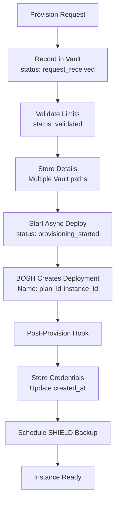
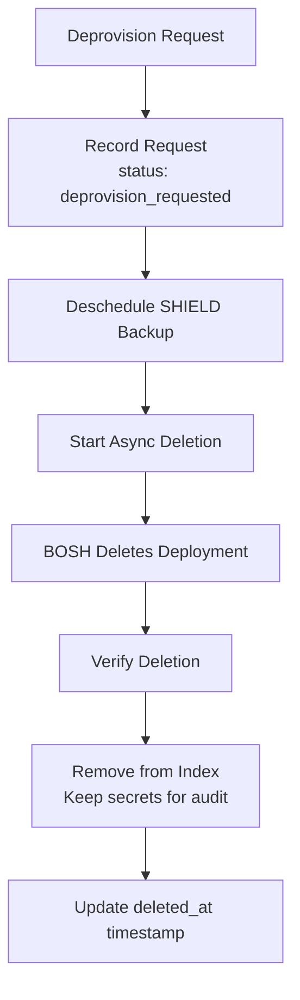
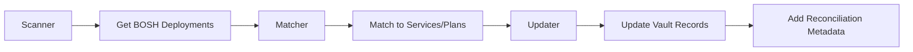
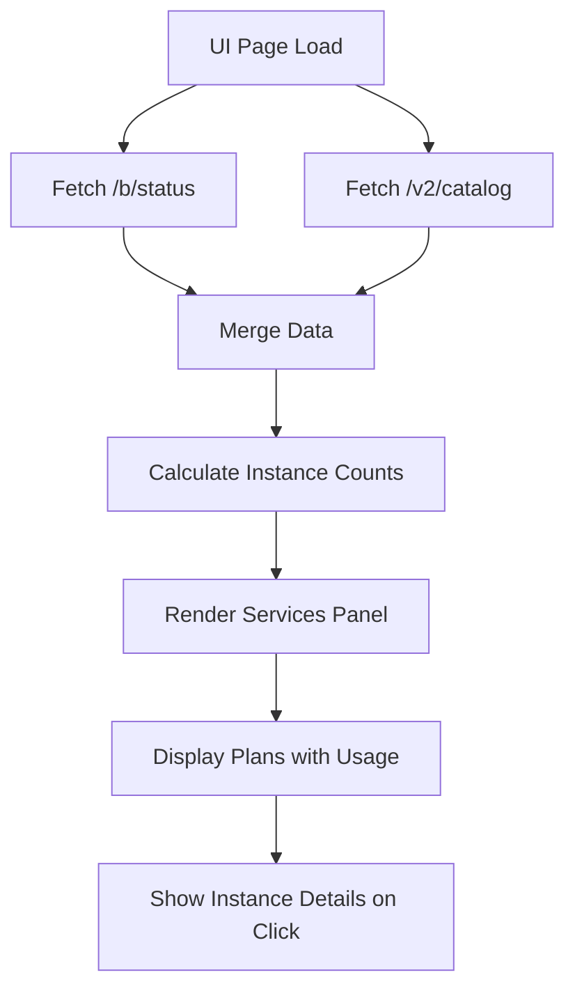

# Service Instance Management Workflow in Blacksmith

## Overview

Blacksmith tracks and manages service instances through a coordinated system involving the UI, backend API, Vault storage, and a reconciler component that ensures consistency between BOSH deployments and tracked instances.

## Architecture Components

### 1. Vault Storage Layer

Service instances are persistently stored in Vault with a multi-path strategy for different aspects of instance data.

#### Primary Index: `db`
The main index at path `db` contains all active service instances, indexed by UUID:

```json
{
  "{instance-uuid}": {
    "service_id": "service-identifier",
    "plan_id": "plan-identifier",
    "created": 1234567890,              // Unix timestamp (legacy)
    "created_at": "2024-01-01T00:00:00Z",
    "requested_at": "2024-01-01T00:00:00Z",
    "status": "provisioning_started",
    "plan": {
      "id": "plan-identifier",
      "name": "Plan Display Name"
    }
  }
}
```

#### Instance-Specific Paths

- **`{instanceID}/`** - Root instance data with flattened fields for backward compatibility
- **`{instanceID}/deployment`** - Deployment-specific information including organization/space details
- **`{instanceID}/{deploymentName}`** - Full provision details object
- **`{instanceID}/manifest`** - BOSH deployment manifest (added by reconciler)
- **`{instanceID}/metadata`** - Historical metadata including lifecycle timestamps
- **`{instanceID}/credentials`** - Service credentials after successful provisioning

### 2. Backend API Layer

#### Status Endpoint: `/b/status`

`GET /b/status` is the primary read for service instance data. It answers with these fields.

- `healthy`, `bosh`, and `vault` report whether the broker is healthy and what it found when it checked the director and Vault.

- `environment`, `env`, `version`, `commit`, and `timestamp` identify the broker and the time of the answer.

- `instances` holds the Vault `db` index, keyed by instance ID.

- `plans` holds the broker's plan configurations.

The status answer has no reconciler section. The orphan state has its own route, which the next section lists.

#### Additional Endpoints

- `GET /v2/catalog` serves the service catalog from the Open Service Broker API, and it takes no body.

- `GET /b/orphans` lists the entries marked orphaned, with the time left before each removal, and the unclaimed BOSH deployments.

- `POST /b/cleanup` is reserved for a manual cleanup job, and it answers 501 Not Implemented today. Any other method gets 405. The reconciler removes orphaned entries on its own.

- `GET /b/blacksmith/settings` reads the broker settings, and `POST /b/blacksmith/settings` changes them. The `POST` takes a JSON body with the optional fields `vault_max_versions`, an integer, and `reconciler_interval`, a duration string such as `5m`. A field the body leaves out keeps its current value.

- `GET /b/blacksmith/changes` lists the audited changes to settings, endpoints, and instances.

- `GET /b/tasks` lists BOSH tasks. It takes `limit` and `offset` for paging, and `counts=1` adds the number of tasks in each state.

- `/b/deployments/{name}/...` serves deployment details and operations, and each route accepts one method.

  `GET /b/deployments/{name}` reads a deployment, `DELETE` removes it, and neither takes a body. `GET` also serves `/manifest`, `/manifest-details`, `/vms`, `/instances`, `/events`, and `/errands`.

  `POST /b/deployments/{name}/manifest` replaces the manifest. Its body is the manifest as a JSON object, and the broker refuses a body that is empty, `null`, or `{}` with a 400 answer.

  `POST /b/deployments/{name}/errands/{errand}` runs an errand. It takes no body, and the query parameters `keep_alive`, `when_changed`, and `instances` shape the run.

  `POST` is the method for `/recreate`, `/restart`, `/stop`, and `/start`. These routes take no body either, and they read optional query parameters such as `skip_drain`, `canaries`, and `max_in_flight`. Any other method gets 405.

- `/b/upgrade/...` runs the batch operations described under [Batch Operations](#8-batch-operations).

  `POST /b/upgrade/tasks` creates a job. Its JSON body names the `instance_ids` and, for an upgrade, the `target_stemcell` and any `target_releases`. The optional fields are `kind`, `name`, `upgrade_preview_id`, and `pause_on_failure`.

  `POST /b/upgrade/preview` previews an upgrade with the same body. `POST /b/upgrade/commands/preview` previews a Run command job, and its body holds `instance_ids`, `command`, `run_as`, `timeout_seconds`, `parallel`, and `max_in_flight`.

  `GET /b/upgrade/tasks` lists the jobs, and `GET /b/upgrade/tasks/{id}` and `GET /b/upgrade/tasks/{id}/output` read one job. `POST /b/upgrade/tasks/{id}/pause`, `/resume`, and `/cancel` change a job's state, and none of them takes a body.

  `GET /b/upgrade/settings` reads the batch settings, and `PUT /b/upgrade/settings` changes them with a JSON body that holds `max_batch_jobs`, an integer.

[broker.md](broker.md) lists every route with its method.

The deployment routes answer only for the deployments of the broker's own service instances. The broker's own deployment can be read and never changed, and any other name gets HTTP 403 with the code `deployment_not_managed`. When the broker cannot read its service index, or has no Vault, the routes answer HTTP 503 with the code `vault_unavailable`, because then nobody knows what the broker owns.

The task routes (`/b/tasks/{id}`, `/b/tasks/{id}/output`, and `/b/tasks/{id}/cancel`) apply the same rule to the deployment the task belongs to. A task with no deployment and a task of the broker's own deployment can both be read, but cancelling either one gets 403. A task of a deployment that the broker managed and then deleted, which the index holds only as a tombstone, can still be read, and cancelling it gets 403. A task of a deployment that was never in the index gets 403 on every one of the three routes. A task the director says does not exist gets 404. When the director cannot answer at all, because it is down or the read fails for any other reason, the routes answer 502 with the code `internal_error`, so a failed read is never mistaken for a missing task. A failed read of a task's output follows the same rule.

The instance routes under `/b/{instance}/`, which cover `vms`, `logs`, `events`, `manifest`, `credentials`, `details`, `config`, `task/log`, and `task/debug`, answer only for an instance that the service index holds as live. The trusted certificate routes, `/b/{instance}/certificates/trusted` and `/b/{instance}/certificates/trusted/file`, follow the same rule on every method, because they write to the instance's own Vault path. The Redis testing routes under `/b/{instance}/redis/` and the RabbitMQ testing routes (`test`, `publish`, `consume`, `queues`, `queue-ops`, and `management` under `/b/{instance}/rabbitmq/`) follow it as well, since they read the instance's credentials. The broker's own certificates sit under `/b/internal/certificates/`, which the router sends to a separate handler that reads files on the broker VM and never touches an instance's Vault path. An ID that was never provisioned, an instance that was deprovisioned, and an ID that holds a backslash or `..` all get HTTP 404 with the code `instance_not_found`, and an index that cannot be read gets 503 `vault_unavailable`. The upgrade routes follow the same rule. An upgrade lists such an ID as failed with the reason that the instance was not found in Vault, and a command preview lists it as blocked with the code `instance_not_found`. A command preview that cannot read the index answers 503 `vault_unavailable`.

### 3. Service Instance Lifecycle

#### Provisioning Workflow



**Key Steps:**

1. **Immediate Recording**: Instance tracked in Vault before any deployment begins
2. **Limit Validation**: Plan limits checked against current usage
3. **Async Deployment**: BOSH deployment initiated in background
4. **Post-Provision**: Credentials fetched and stored, backups scheduled

#### Deprovisioning Workflow



**Important Notes:**
- Instance only removed from index after confirmed BOSH deletion
- Secrets preserved in Vault for audit purposes (never deleted)
- Deletion timestamps tracked in metadata

### 4. Reconciler Component

The reconciler ensures consistency between BOSH deployments and Vault records.

#### Configuration

Environment variables control reconciler behavior:

| Variable | Default | Description |
|----------|---------|-------------|
| `BLACKSMITH_RECONCILER_ENABLED` | `true` | Enable/disable reconciler |
| `BLACKSMITH_RECONCILER_INTERVAL` | `5m` | Scan interval, overridden by an interval saved through the UI |
| `BLACKSMITH_RECONCILER_MAX_CONCURRENT` | `4` | Parallel operations |
| `BLACKSMITH_RECONCILER_BATCH_SIZE` | `10` | Instances per batch |
| `BLACKSMITH_RECONCILER_RETRY_ATTEMPTS` | `3` | Retry failed operations |

[reconciler.md](reconciler.md) lists the remaining settings and explains how the interval is chosen.

#### Reconciliation Process



**Reconciliation adds:**
- `reconciled: true` flag
- `reconciled_at` timestamp
- Updated manifest if changed

#### Orphan Detection

The reconciler marks and then sweeps orphans, and it does not remove an entry the first time it finds the deployment missing.

1. It retrieves all BOSH deployments, and it stops marking when the scan comes back empty.

2. It checks each Vault instance for a deployment named `{plan_id}-{instance_id}`.

3. An entry with no deployment gets `orphaned`, `orphaned_at`, and an `orphaned_reason` of `no_bosh_deployment`, and each later run that still finds it missing adds one to `orphan_check_count`.

4. A deployment that comes back clears the mark.

5. The reconciler removes a marked entry when it is more than 24 hours old or has been missing on 24 runs, whichever comes first.

6. A separate sweep removes an entry sooner when it is at least two hours old, the director answers 404 for the deployment, the director has no running task on it, and the instance's task record shows nothing in flight.

Removal drops the index entry and keeps the secrets, as a normal deprovision does. A broker restart gives marked entries a fresh 24 hours.

The reconciler also reports BOSH deployments that have no index entry and no Cloud Foundry instance. It reports these as unclaimed and does not adopt them. [reconciler.md](reconciler.md) has the full rules.

#### Tombstones From the VM Monitor

When the VM monitor cannot list a deployment's VMs and the director confirms the deployment does not exist, the monitor marks the instance's index entry `deleted` and stops monitoring it. The reconciler skips entries marked `deleted`, and the orphan sweep removes them once the same checks pass. A tombstone that names no deployment goes on age alone.

#### CredHub Cleanup

When `credhub.cleanup` is enabled, the broker also removes the CredHub credentials of a deployment that a deprovision or a sweep has removed. The cleanup runs only after the index save that removed the entry succeeds. The `sweep` setting chooses whether a separate pass over CredHub reports (`dry-run`) or deletes (`delete`) the credentials that no longer belong to an instance. [config.md](config.md) describes the settings.

### 5. UI Integration

#### Data Flow



#### UI Processing

1. **Data Fetching**: Parallel requests to `/b/status` and `/v2/catalog`
2. **Data Merging**: Combines catalog metadata with instance data
3. **Count Calculation**: Tallies instances per plan
4. **Plan Enhancement**: Adds instance count and limit to each plan
5. **Rendering**: Updates services panel with enriched data

The Summary page also reads `GET /b/orphans` and shows the entries waiting for removal.

### 6. Status Progression

The index entry of a service instance carries the status the broker last wrote.

| Status | Description |
|--------|-------------|
| `request_received` | Initial provision request recorded |
| `validated` | Limits and parameters validated |
| `provisioning_started` | BOSH deployment initiated |
| `deprovision_requested` | Deletion requested |
| `deleted` | The VM monitor or the reconciler found the deployment gone and left a tombstone |

The broker writes no status for a failed provision. The last-operation answer reports the failure to the platform, and a failure before the deployment starts removes the entry the broker created. A deprovision ends with the entry removed from the index. The broker keeps the progress of a running operation in its task record, and that record, not the index status, answers last-operation polls.

### 7. Data Consistency Strategies

#### Eventual Consistency
- Reconciler periodically synchronizes Vault with BOSH state
- Handles deployments created/deleted outside normal flow
- Updates stale or missing metadata

#### Failure Handling
- Failed provisions: The platform sees the failure, and a failure before the deployment starts removes the entry the broker created
- Failed deprovisions: Instance retained in index for investigation
- Network failures: Retry logic with exponential backoff

#### Audit Trail
- All lifecycle events timestamped
- Deleted instances keep vault data minus index entry
- Reconciliation history maintained in metadata
- Changes to settings, endpoints, and instances are recorded and served at `GET /b/blacksmith/changes`

### 8. Batch Operations

Operators run work across many instances from the console's Batch Operations page, and the same operations sit behind `/b/upgrade`. Each one is a task that lists its instances and works through them, and it can pause so an operator can look before it goes on. A command task always pauses after a failure, and the other kinds pause when the operator asks them to. The three kinds of task are these.

- **Upgrade**
  Redeploys instances against a newer release or stemcell. `POST /b/upgrade/preview` shows what would change.

- **Certificates**
  Rotates and redeploys certificates, or patches them in place when `certificates.patch_in_place` and rotation are both enabled. Inventory is on by default, and rotation is off until an operator enables it.

- **Command**
  Runs one command on every VM of the selected instances, as `vcap` or `root`. [run-command.md](run-command.md) describes the preview, the audit record, and the HTTP routes.

A task is created with `POST /b/upgrade/tasks`, listed with `GET /b/upgrade/tasks`, and read with `GET /b/upgrade/tasks/{id}`. Operators steer it with `pause`, `resume`, and `cancel`, and the per-instance decisions that some tasks wait for go to `/b/upgrade/tasks/{id}/instances/{instance-id}/{action}`.

## Key Design Decisions

### 1. Dual Storage Strategy
- **Index**: Fast lookups and queries
- **Detailed Paths**: Complete data preservation

### 2. Asynchronous Operations
- All BOSH operations are async with status polling
- UI uses LastOperation pattern for status updates

### 3. Naming Convention
- Deployments: `{plan_id}-{instance_id}`
- Enables automatic correlation between BOSH and Vault

### 4. Preservation Over Deletion
- Audit requirements satisfied by keeping deleted instance data
- Only index entries removed, not underlying secrets

### 5. Reconciliation Safety
- Read-only scanning of BOSH
- Non-destructive Vault updates
- Preserves manual changes while adding metadata
- Orphans are marked first and removed only after a grace period or a director confirmation

## Monitoring and Observability

### Metrics Available
The reconciler keeps counters in memory for its runs, successes, failures, deployments scanned, instances found and synced, errors, and run durations. The broker does not serve them over HTTP, so the log lines that each run writes are the way to watch it. For orphans, call `GET /b/orphans`.

### Log Points
- Instance lifecycle transitions
- Reconciliation actions
- Orphan detection and cleanup
- API request/response cycles

### Health Checks
- `/b/internal/health` for the broker
- Vault connectivity
- BOSH director availability
- Index consistency validation

## Security Considerations

1. **Credential Storage**: Service credentials stored encrypted in Vault
2. **Access Control**: Vault ACLs control instance data access
3. **Audit Logging**: All modifications tracked with timestamps
4. **Data Retention**: Deleted instances retained for compliance
5. **TLS Communication**: All BOSH/Vault communication over TLS

## Troubleshooting Guide

### Common Issues

#### Orphaned Instances
- **Symptom**: Instances in UI with no backing deployment
- **Solution**: Wait for the reconciler, which removes orphaned entries on its own. The Summary page and `GET /b/orphans` list them with the time left before removal

#### Stuck Provisioning
- **Symptom**: Instance stays in `provisioning_started`
- **Check**: BOSH task status through `GET /b/tasks` or the deployment events
- **Solution**: Check BOSH logs, may need manual intervention

#### Missing Instance Data
- **Symptom**: Incomplete instance information in UI
- **Solution**: The next reconciler run rebuilds metadata. Lower the interval through `POST /b/blacksmith/settings` or restart the broker to get a run sooner

#### Reconciler Not Running
- **Check**: The log for `Deployment reconciler started successfully`, and `GET /b/blacksmith/settings` for the interval in force
- **Solution**: Verify environment variables and restart

### Debugging Commands

In these examples, `BROKER_USER` and `BROKER_PASS` hold the broker's basic-auth credentials.

```bash
# See what is marked orphaned and what is unclaimed
curl -s -u "$BROKER_USER:$BROKER_PASS" http://blacksmith/b/orphans

# Read the reconciler interval in force
curl -s -u "$BROKER_USER:$BROKER_PASS" http://blacksmith/b/blacksmith/settings

# See the latest audited settings changes
curl -s -u "$BROKER_USER:$BROKER_PASS" "http://blacksmith/b/blacksmith/changes?scope=settings&limit=10"

# Page through BOSH tasks, with counts per state
curl -s -u "$BROKER_USER:$BROKER_PASS" "http://blacksmith/b/tasks?limit=50&offset=0&counts=1"

# Check the BOSH deployment through Blacksmith's API
curl -s -u "$BROKER_USER:$BROKER_PASS" http://blacksmith/b/deployments/{plan-id}-{instance-id}/instances
```

## Future Enhancements

1. **Real-time Updates**: WebSocket support for live instance status
2. **Enhanced Metrics**: Prometheus/Grafana integration
3. **Backup/Restore**: Full instance state backup capability
4. **Multi-region**: Cross-region instance management